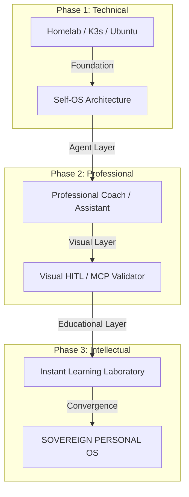

# Vision — The Sovereign Learning Laboratory & Personal OS

## Overview
This document synthesizes the convergence of multiple KπX workstreams into a single, cohesive "Mega-Project": **The Sovereign Personal OS**. 

It transitions from a purely technical infrastructure (Homelab/K3s) to a professional coaching layer, and finally to a revolutionary **Real-time Learning Laboratory**.

## The Three Pillars of the Personal OS

### 1. The Technical Foundation (Self-OS) — "The Workbench"
*   **Infrastructure:** Homelab, K3s distributed cluster (Phoenix V4.0), Multi-node orchestration.
*   **Data Sovereignty:** Local storage, DKD Vault, Rclone cloud-layer, 0-trust architecture.
*   **Identity:** Sovereign M2M identity, local LLMs (Ollama-IPEX), and private agent sandboxes (WebTop).

### 2. The Agentic Proxy (Professional Assistant) — "The Coach"
*   **HITL Operations:** Visual Validation (Visual Validator project) across all communication channels (WhatsApp, Mail, LinkedIn).
*   **Action Orchestration:** TickTick unified task management, automated session logging, and cross-agent memory.
*   **Workflow Integration:** M365 CLI, GitHub-to-GitLab pipelines, and techskills optimization.

### 3. The Learning Laboratory (Instant Content Engine) — "The Laboratory"
*   **Live Generation:** Eliminating the high cost of educational content (manual YouTube editing, site building) by generating visuals (Manim, Napkin AI, Mermaid) in real-time during explanation.
*   **Adaptive Intelligence:** An assistant that knows KpihX's style, history, and academic path (ScienCurious Lab), adapting the difficulty and visual complexity in live.
*   **Convergence with Education:** Transforming ScienCurious Lab from a static Docsify site into a dynamic, interactive environment where "everything is live".

## Evolutionary Path: From Homelab to Sovereign Intelligence

## Key Strategic Goals
*   **Zero Magic, 100% Transparency:** Every visual and code block generated must be inspectable and modifiable by KpihX.
*   **Instant Context Recall:** Leveraging the agent's memory (k-context, QMD) to ensure the learning path is never redundant.
*   **Content Cost Reduction:** Moving from hours of production to seconds of generation.

## Related Brainstorms
*   `references/mcp-visual-validation-vision.md` (The UI/Validation layer)
*   `references/vision/visual-ai-vision.md` (The Graphic generation engine)
*   `references/phoenix-v4-k3s-agent-sandbox-vision.md` (The Sandbox/Environment)
*   `references/agentic-architecture-brainstorm.md` (The cognitive model)
