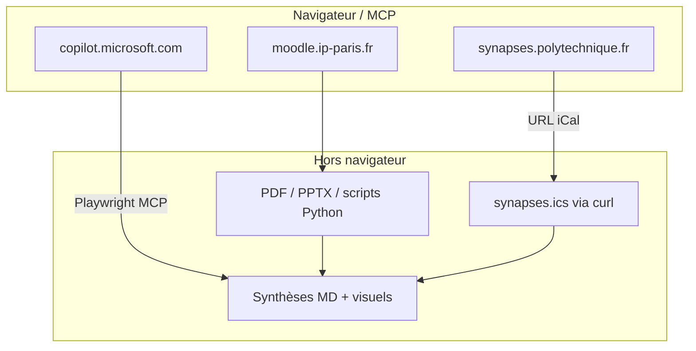

# Workflows — Portails académiques (Moodle, SynapseS, Copilot)

> Retour d’expérience validé **2026-05-26** (IME_43031_EP — Fondamentaux des Organisations).
> Chaîne : **Moodle (téléchargement)** → **SynapseS (emploi du temps)** → **Copilot (conversation multi-tours)**.

## Pipeline type



---

## 0. Prérequis MCP

| Outil | Quand | Vérification |
|-------|--------|--------------|
| **Playwright MCP** (`playwright-mcp-stdio`) | Navigation, Copilot, snapshots | `browser_tabs` list |
| **Browser MCP** (`browser-mcp-stdio`) | Onglet Edge **déjà ouvert** par KπX | `browser_tab_list` — si `Not connected` → lancer `edge-agent` |
| **Edge agent** | Session Microsoft connectée | `edge-agent-status` → CDP `:9222` |

**Règle :** si KπX dit « j’ai ouvert X dans Edge » mais Browser MCP est déconnecté, utiliser **Playwright** (onglet dédié, même compte si profil connecté) **ou** demander de relancer `edge-agent` + recharger MCP.

---

## 1. Moodle — télécharger les supports de cours

### Objectif

Récupérer PDF, PPTX, liens vidéo (HLS), sans cliquer fichier par fichier.

### Approche retenue

1. **Session authentifiée** via cookies Edge (`MoodleSession`).
2. Script Python **`requests`** + manifeste des URLs (pas de scraping aveugle à chaque run).

### Référence projet (exemple IME)

| Fichier | Rôle |
|---------|------|
| `download_moodle_course.py` | Télécharge ressources Moodle (cookies Edge) |
| `download_videos_batch.sh` | Télécharge MP4 depuis `00_Meta/video_streams.json` (ffmpeg, HLS sans audio souvent) |
| `organize_course_files.py` | Préfixe `01_`…`08_`, déplace vidéos par séance |
| `00_Meta/download_log.json` | Journal |

### Cookies (point critique)

```python
COOKIE_DB = Path.home() / ".config/microsoft-edge/Default/Cookies"
# Clé : MoodleSession pour moodle.ip-paris.fr
```

- Profil **quotidien** : `microsoft-edge/Default`
- Profil **agent** : `kpihx-edge-automation/Default` — cookies **séparés** ; si téléchargement échoue (401), vérifier que la session Moodle est dans le profil lu par le script.

### Commandes

```bash
cd "$HOME/Work/Studies/IP-Paris/IME_43031_EP-Fondamentaux-Organisations_2025-2026"

python3 download_moodle_course.py          # documents
bash download_videos_batch.sh              # vidéos (long)
python3 organize_course_files.py           # nomenclature séances
```

### Piège vidéos Ubicast / MediaServer

- Flux **720p souvent vidéo seule** (`ffprobe` → pas de piste audio).
- Whisper inutile ; extraire **frames + mini-clips** (`transcribe_course_videos.py` + `video_visuals.py`).
- `build_visuals_assets()` doit accepter **VTT absent** (détection scènes ffmpeg seule).

### Monitoring téléchargement vidéo (tmux)

```bash
# Append log, pas clear (sinon écran figé)
bash 00_Meta/run_watch_pane.sh   # writer + tail -f 00_Meta/video_watch.log
```

---

## 2. SynapseS — emploi du temps (N semaines)

### Objectif

Afficher **plusieurs semaines** de créneaux (pas seulement la semaine visible dans FullCalendar).

### Méthode fiable : export iCal

1. **Navigateur** : ouvrir `https://synapses.polytechnique.fr/` (connecté).
2. Bas de page → **« Adresse de synchronisation »** → champ `#input-url-sync-agenda`.
3. **Lire l’URL** (JS ou snapshot) — token personnel, ne pas commiter.

```javascript
document.querySelector('#input-url-sync-agenda')?.value
```

4. **Télécharger** le calendrier complet :

```bash
curl -sL "https://synapses.polytechnique.fr/calendar/ical/VOTRE_TOKEN" -o /tmp/synapses.ics
```

5. **Parser** avec le script skill (ou Python inline) — filtrer `DTSTART` entre deux dates.

### Groupes PC (petites classes)

Le numéro de groupe **n’apparaît pas** dans le titre du créneau ; il est dans le corps ICS :

```text
DESCRIPTION:…
Groupe : Groupe2
Intervenants : …
Salles : BEM-2009 (1022009)
```

- **CM** → souvent `Groupe : Tous les étudiants`
- **PC** → `Groupe : GroupeN` ou `Groupe N` — c’est la réponse « mon groupe de PC »
- Consolidation durable : `$HOME/.agents/skills/kpihx/references/x.md` § **Emploi du temps & groupes PC**

### Script réutilisable (skill)

```bash
# Depuis le skill k-browser
python3 "$HOME/.agents/skills/k-browser/scripts/synapses-agenda.py" \
  --url "https://synapses.polytechnique.fr/calendar/ical/XXXX" \
  --from 2026-05-25 --to 2026-06-14
```

### Méthode rapide (une semaine seulement)

```javascript
// Dans la page SynapseS — événements déjà chargés
jQuery('.fc').fullCalendar('clientEvents')
```

→ Insuffisant pour 3 semaines ; préférer **iCal**.

### Affichage navigateur

- Boutons **Semaine** / **Mois** / flèches prev-next.
- En-tête type `25 – 30 mai 2026`, colonnes `lun. 25/5` …

---

## 3. Microsoft Copilot — conversation multi-tours (≥10 échanges)

### Objectif

Enchaîner messages avec **pause** entre chaque réponse (KπX observe visuellement).

### Outil : Playwright MCP (recommandé)

| Étape | Action MCP |
|-------|------------|
| Ouvrir | `browser_tabs` action `new` → `https://copilot.microsoft.com/` |
| Saisie | `browser_type` sur `getByTestId('composer-input')`, `submit: true` |
| Attente | `browser_wait_for` **time: 20–25** (secondes) |
| Vérif | `browser_snapshot` — articles `You said` / `Copilot said` |
| Capture | `browser_take_screenshot` fullPage (optionnel) |

### Sélecteurs stables (2026-05-26)

```javascript
page.getByTestId('composer-input')   // zone de message
// Envoi : fill + press('Enter')
```

Ancien insight `#userInput` — **remplacé** par `composer-input` sur l’UI actuelle.

### Cookie banner (si page fraîche)

```javascript
page.getByTestId('cookie-banner-accept-button').evaluate(el => el.click())
```

### Boucle type (pseudo-code MCP)

```
pour message in messages[1..10]:
  browser_type(composer-input, message, submit=true)
  browser_wait_for(time=22)
  browser_snapshot()  # optionnel
```

**Ne pas** enchaîner 10 messages dans un seul `browser_run_code` >60s — **timeout MCP**. Envoyer **un message par tour** ou paquets de 2–3 max.

### URL de conversation

Après le premier envoi : `https://copilot.microsoft.com/chats/<id>` — réutiliser cette URL pour reprendre le fil.

### Edge vs Playwright

| Contexte | Comportement |
|----------|--------------|
| KπX ouvre Copilot dans **Edge** | Browser MCP doit être connecté (`edge-agent`) |
| Browser MCP down | Playwright ouvre **son** Chromium — session Microsoft souvent déjà connectée (profil séparé) |
| KπX veut voir **son** onglet Edge | Reconnecter MCP ou dupliquer le chat via lien |

### Timing

- Réponse courte : **15–20 s**
- Réponse longue (listes) : **25–30 s**
- Signaler à KπX : onglet Playwright vs Edge si les deux ne sont pas la même fenêtre

---

## 4. Checklist agent — session « portails académiques »

- [ ] `edge-agent-status` si interaction Edge live demandée
- [ ] Moodle : cookies OK → `download_log.json` sans 401 massifs
- [ ] Vidéos : noter **audio absent** avant Whisper
- [ ] SynapseS : **iCal** pour multi-semaines, pas seulement `clientEvents`
- [ ] Copilot : **1 message / wait / message** ; `composer-input`
- [ ] **Leave no trace** : fermer onglets test sauf si KπX veut garder le chat Copilot

---

## 5. Fichiers à patcher après une session réussie

| Fichier | Contenu |
|---------|---------|
| `k-browser/references/insights.md` | Pièges nouveaux (1 ligne chacun) |
| `k-browser/references/workflows-academic-portals.md` | Ce runbook |
| Projet cours `README.md` | Commandes locales |
| `$HOME/Work/techskills/edge-agent-cdp-setup.md` | Si nouveau cas Edge |

---

## 6. Liens projets

- IME cours : `$HOME/Work/Studies/IP-Paris/IME_43031_EP-Fondamentaux-Organisations_2025-2026/`
- SynapseS : `https://synapses.polytechnique.fr/`
- Moodle IP Paris : `https://moodle.ip-paris.fr/`
